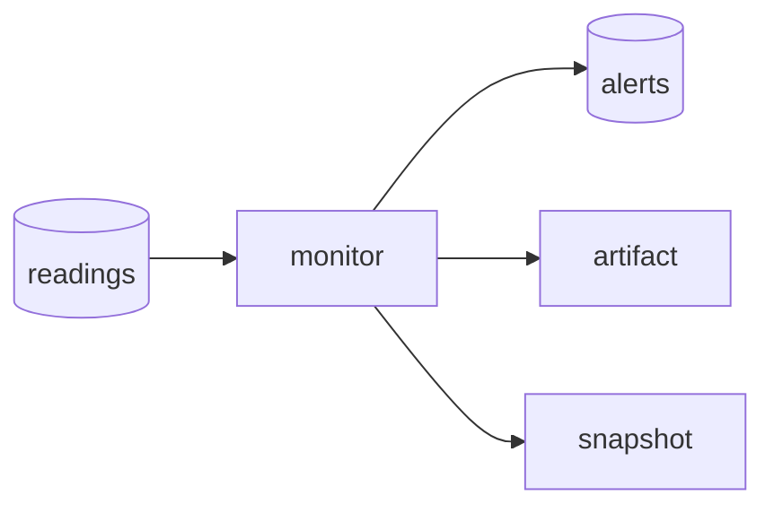
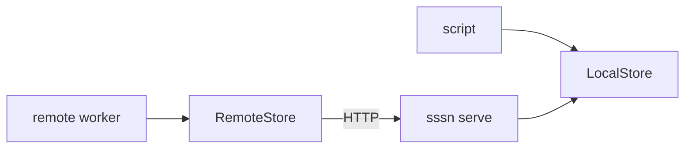

# How SSSN works

SSSN connects systems through **data** instead of calls. A writer appends
events to a channel and moves on; readers take them later, each at its own
pace, from a store that keeps everything in order. Six objects carry the
whole design:

| Object | Role | Holds | Guide |
| --- | --- | --- | --- |
| **Channel** | The address | a name, a form, a schema ref, a description | [Channels and events](channels.md) |
| **Event** | The record | a JSON payload in an envelope of ids and links | [Channels and events](channels.md#appending-events) |
| **Artifact** | The bulk data | bytes, linked to events by id | [Artifacts and snapshots](artifacts.md) |
| **Snapshot** | The current state | the latest value of a name | [Artifacts and snapshots](artifacts.md#snapshots) |
| **Subscription** | The reader | a named cursor over one channel | [Subscriptions](subscriptions.md) |
| **Store** | The home of all five | a folder, or a server in front of one | [Stores](stores.md) |

## One round trip, step by step

A greenhouse sensor writes temperature readings. A monitor reads them,
raises an alert for a reading that is too hot, saves a chart, and keeps a
status that a dashboard can read in one call:



```python title="round_trip.py"
from sssn import LocalStore

store = LocalStore(".lllm/network")
store.create_channel({"name": "readings", "form": "time-series"})
store.create_channel({"name": "alerts"})

for celsius in [21.5, 22.0, 31.2]:  # (1)!
    store.append_event(
        {
            "channel": "readings",
            "kind": "temperature",
            "source": "greenhouse-1",
            "correlation_id": "greenhouse-1",
            "payload": {"celsius": celsius},
        }
    )

store.create_subscription("readings", subscription_id="monitor")  # (2)!
for reading in store.pull_subscription("monitor"):
    if reading.payload["celsius"] > 30:
        alert = store.append_event(  # (3)!
            {
                "channel": "alerts",
                "kind": "too-hot",
                "source": "monitor",
                "correlation_id": reading.correlation_id,
                "parent_ids": [reading.id],
                "payload": {"celsius": reading.payload["celsius"]},
            }
        )
        chart = store.write_artifact(  # (4)!
            b"<svg>...</svg>",
            media_type="image/svg+xml",
            event_ids=[alert.id],
        )
        store.put_snapshot(  # (5)!
            "greenhouse-1-status",
            {"status": "too hot", "chart": chart.id},
            source_event_id=alert.id,
        )

status = store.get_snapshot("greenhouse-1-status")  # (6)!
alert = store.get_event(status.source_event_id)
reading = store.get_event(alert.parent_ids[0])
print(status.value["status"], "<-", alert.kind, "<-", reading.payload)
#> too hot <- too-hot <- {'celsius': 31.2}
print(store.pull_subscription("monitor"))  # (7)!
#> ()
```

1. The sensor is a producer. It appends and moves on, without knowing who
   reads the channel. `kind` says what the event is, `source` who wrote
   it, and `correlation_id` groups the events of one greenhouse.
2. The monitor reads through a subscription: a cursor, saved in the store
   under the name `monitor`.
3. A derived event lists the event it came from in `parent_ids` and keeps
   its correlation id, so the alert can be traced to its reading.
4. The chart is bytes, not a record, so it goes in an artifact, linked to
   the alert. The alert stays small.
5. The status is state: the next write replaces it. It points at the event
   that produced its value.
6. A reader starts from the current state and follows the links back:
   snapshot, then alert, then reading.
7. The cursor moved past all three readings, so a restarted monitor would
   not alert twice.

Each step is a store method, and nothing else is involved: no broker to
run, no schema registry, no callbacks. The same calls work against a store
on another machine.

## Events are facts, snapshots are state

Events are appended and never changed: the store has no method to update or
delete an event, or a channel. That rule is what makes channels safe to
share. A reader that falls behind loses nothing, a new reader can start
from the first event, and any state derived from a channel can be rebuilt
by reading it again.

State that changes goes into a snapshot, which a write replaces whole.
Snapshots keep no history; the channel is the history, and a snapshot's
`source_event_id` says which event its value came from. Bulk data goes into
artifacts, so events stay small enough to scan and to send over HTTP.

The envelope around each payload is what lets systems that do not know
each other cooperate:

| Field | Answers |
| --- | --- |
| `id`, `cursor` | Which event is this, and where is it in the store? |
| `kind` | What happened? Readers filter on it. |
| `source` | Who wrote it? |
| `correlation_id` | Which piece of work does it belong to? |
| `parent_ids` | Which events was it derived from? |
| `schema`, `metadata` | How to read the payload, plus small hints |

[Channels and events](channels.md#appending-events) has every field and
its default.

## Readers own their position

A subscription is a reader's bookmark, and the store keeps it. Readers do
not share one: a dashboard, an indexer, and an alerting worker can each
read the same channel through their own subscription, and none of them
consumes events for the others. A reader that crashes resumes from its
saved cursor.

To process every event at least once, a reader reads the next event, acts
on it, and moves its cursor only when the work is done.
[Subscriptions](subscriptions.md#acknowledging-events) shows the pattern,
and `TacticProcessor` implements it for tactics
([Processing with tactics](processing.md)).

## Stores are backing implementations

The store methods (`create_channel`, `append_event`, `query_events`,
`create_subscription`, `pull_subscription`, `write_artifact`,
`put_snapshot`, and their readers) are the stable `Channel` interface.
SQLite, a broker, a database, or a hosted service can be backing
implementations behind it, and code that uses the interface does not change
when the backend does. SSSN 0.2 ships one backend and one way to share it:



- `LocalStore` keeps a store in a folder: SQLite for the records and
  cursors, and plain files for artifact bytes. It is deliberately boring,
  so tests and demos are deterministic.
- `sssn serve` (or `create_app` in your own app) puts a store behind a
  portable HTTP API, and `RemoteStore` and `AsyncRemoteStore` call it with
  the same methods as `LocalStore`.

Code written against `LocalStore` runs against `RemoteStore` unchanged,
and `AsyncRemoteStore` has the same methods as coroutines. See
[Stores](stores.md) and [Over HTTP](http.md).

## A data plane, not observability

Channels carry domain data that other systems consume: tickets, sensor
readings, analysis results, human annotations, robot state, the latest
plan. Name channels for what they carry, such as `policy-samples`,
`robot-state`, or `annotations`.

Traces, logs, metrics, and costs describe how your software behaves, and
they belong in an observability tool such as OpenTelemetry or Logfire
([LLLM observability](https://lllm.one/observability/)). The test is who
reads the data: if another system acts on it, it belongs in a channel.

## Where SSSN sits

LLLM composes, SSSN connects, and AAAX exposes. A tactic is a call: a
request goes in and a result comes out, while the caller waits. A channel
is a hand-off that outlives its writer and waits for its readers.
`TacticProcessor` joins the two by running a tactic over a channel's
events. An LLLM package declares its channels in `lllm.toml`, `lllm://`
refs bind them to stores ([Packages and refs](packages.md)), and
[AAAX](https://aaax.one/) serves a package's tactics and channels as one
API.
