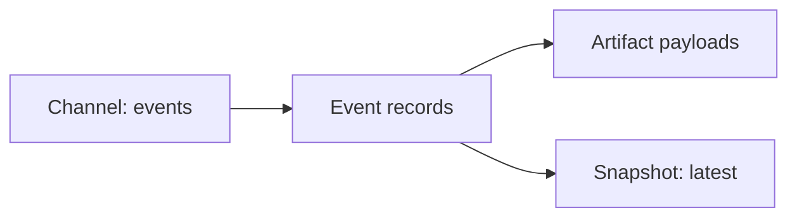

# Channels

`Channel` is SSSN's center model. A channel is a named semantic data interface
with schema, form, description, and metadata.

The protocol layer is the stable part. Stores, brokers, databases, feeds,
graph stores, object stores, and local filesystems are backing implementations
behind the channel interface.

## Design Lineage

SSSN treats a channel as a domain-neutral communication boundary. Its design
lineage comes from two complementary agentic settings:

- **Society: pub/sub flow for living analysis.** In SocioDojo, real-world text,
  news, articles, and time-series signals flow into lifelong analytical agents
  as continuously updated societal context. SSSN keeps that pattern as
  `topic`, `log`, and `time-series` channels that services can publish to and
  workers can subscribe from.
- **Science: blackboard for distributed discovery.** In Language Modeling by
  Language Models, Genesys works like a small artificial academia: agents share
  findings, literature, code, experiments, coordination notes, evaluations, and
  results, then inspect, challenge, and extend that shared evidence. SSSN keeps
  that pattern as events, artifacts, snapshots, and derived channels.

The result is deliberately neutral: the same `Channel` contract can carry
societal feeds, scientific discovery traces, business events, robot telemetry,
or any other semantic stream. It is also compatible with ROS-style topic
thinking in robotics, while staying a semantic data protocol rather than robot
middleware.

```python
from sssn import Channel

channel = Channel(
    name="events",
    schema="demo.schemas:Event",
    form="log",
    description="Local event stream.",
)
```

## Channel Forms

A form says how a channel is meant to be used. `Channel.form` is one of:

| Form | Meant for |
| --- | --- |
| `log` | Append-only event history (the default). |
| `queue` | Work items that consumers take in order. |
| `topic` | Broadcast or pub/sub streams. |
| `blackboard` | A shared surface where agents post and build on findings. |
| `latest-state` | The latest materialized state for a key. |
| `artifact-index` | Event metadata over larger payloads. |
| `pipeline-edge` | The hand-off between two processing stages. |
| `database-view` | Records mirrored from, or derived for, a database. |
| `feed` | Items from an outside source as they arrive. |
| `time-series` | Ordered observations with temporal meaning. |
| `tree` | Records that form a hierarchy through parent links. |
| `forum` | Threads of posts and replies. |
| `hub` | A meeting point that gathers several channels. |

Any other value fails validation. The LLLM hub checks `[channels.<name>]`
forms in package manifests against the same list.

The form is metadata, not a hard-coded backend: `LocalStore` keeps every
channel as an append-only log whatever its form, and a future broker-backed
implementation can advertise the same channel contract. Channels cannot be
updated or deleted through the API, and creating a channel whose name is taken
raises `ChannelExistsError`.

## Events, Artifacts, Snapshots

Channels group related semantic data. Events are the append-only facts.
Artifacts hold larger payload bytes. Snapshots materialize the latest state
that a worker or service wants to read quickly.



Use channels when the name carries domain meaning: `policy_samples`,
`analysis`, `robot_state`, `human_annotations`, `detections`, or
`latest_plan`.

## Validation

Channel names are portable resource names. Keep them non-empty and path-like:
letters, numbers, underscores, and hyphens are the most predictable choice.
Avoid whitespace, path separators, percent escapes, and path-control segments
so names can appear safely in URLs, refs, package cards, and local config.

## References

- Cheng, Junyan, and Peter Chin. "SocioDojo: Building Lifelong Analytical Agents
  with Real-World Text and Time Series." *The Twelfth International Conference
  on Learning Representations (ICLR)*, 2024. Spotlight.
- Cheng, Junyan, Peter Clark, and Kyle Richardson. "Language Modeling by
  Language Models." *Advances in Neural Information Processing Systems 38
  (NeurIPS 2025)*, 2025. Spotlight.
