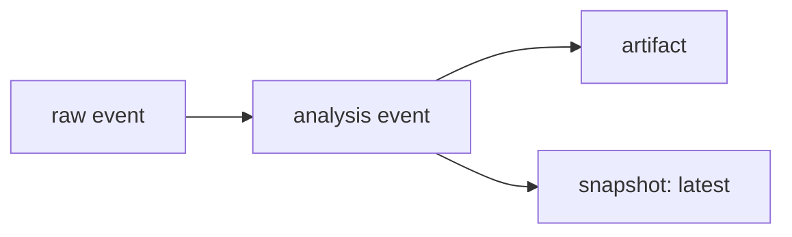

# Events, Artifacts, Snapshots

SSSN separates three data shapes so channels can carry both small semantic
records and larger payloads without turning every event into an object store.

| Resource | Use |
| --- | --- |
| `Event` | Append-only semantic record in a channel. |
| `Artifact` | Larger payload stored by reference. |
| `Snapshot` | Latest materialized state for a name. |

The examples on this page run top to bottom as one session.

## Events

Events can carry schema refs, kind, source, metadata, correlation IDs, and
parent event IDs:

```python
from sssn import Event, LocalStore

store = LocalStore(".lllm/network")
store.create_channel({"name": "events"})

event = store.append_event(
    Event(
        channel="events",
        source="demo",
        kind="raw",
        payload={"text": "hello"},
        correlation_id="corr-1",
    )
)
print(event.kind, event.correlation_id, event.cursor > 0)
```

```text
raw corr-1 True
```

| Field | Default | Meaning |
| --- | --- | --- |
| `id` | random UUID | Unique in the store. You may set your own (a path segment); appending an id that exists raises `EventExistsError`. |
| `cursor` | assigned by the store | Position in the store, store-wide, so a channel's cursors are ordered but have gaps. |
| `channel` | required | Must exist. |
| `timestamp` | now | Seconds since the epoch, as a float. |
| `source` | `None` | Who wrote it: a service, a processor, `cli`. |
| `kind` | `"event"` | A token that consumers filter on (`message`, `result`, `error`, ...). |
| `payload` | `None` | Any JSON value. Pydantic models are stored as JSON and read back as dicts. |
| `schema` | `None` | Optional schema ref for the payload. |
| `metadata` | `{}` | JSON object for small hints. |
| `correlation_id` | `None` | Groups related events across channels: a ticket, a run, an episode. |
| `parent_ids` | `()` | Ids of the events this one was derived from, in any channel. |

Parent IDs let a derived event point back to the raw events that produced it.
Local stores reject parent IDs that do not point at existing events, which keeps
processor chains inspectable:

```python
derived = store.append_event(
    {
        "channel": "events",
        "kind": "analysis",
        "payload": {"length": 5},
        "correlation_id": event.correlation_id,
        "parent_ids": [event.id],
    }
)
print(store.get_event(derived.parent_ids[0]).payload)
```

```text
{'text': 'hello'}
```

## Artifacts

Artifacts are for payloads that should not live inline in every event: binary
files, model outputs, reports, images, traces, or large JSON blobs.

```python
artifact = store.write_artifact(
    b"hello",
    media_type="text/plain",
    event_ids=[event.id],
    metadata={"role": "demo"},
)
print(store.get_artifact(artifact.id).metadata)
print(store.read_artifact(artifact.id))
```

```text
{'role': 'demo'}
b'hello'
```

Artifact metadata remains queryable without downloading payload bytes. The
payload path stays behind the store API. `write_artifact` takes `bytes`,
`bytearray`, or `memoryview`; its `channel` and every id in `event_ids` must
exist. Payload files are content-addressed, so the same bytes written twice
make two artifact records that share one file.

## Snapshots

Snapshots hold latest materialized state:

```python
from sssn import Snapshot

store.put_snapshot(
    Snapshot(
        name="latest",
        channel="events",
        value={"status": "ok"},
        source_event_id=event.id,
    )
)
print(store.get_snapshot("latest").value)
```

```text
{'status': 'ok'}
```

`put_snapshot` takes a `Snapshot`, a dict of snapshot fields, or a name and a
value with the other fields as keywords. Every store (`LocalStore`,
`RemoteStore`, `AsyncRemoteStore`) takes the same arguments:

```python
store.put_snapshot({"name": "latest", "value": {"status": "degraded"}})
store.put_snapshot("latest", {"status": "ok"}, channel="events")

latest = store.get_snapshot("latest")
print(latest.value, latest.channel, latest.source_event_id)
```

```text
{'status': 'ok'} events None
```

A write replaces the whole snapshot: fields you leave out are reset, as
`source_event_id` is above. The value is stored exactly as given, so
`put_snapshot("config", {"value": 3, "unit": "ms"})` stores the whole dict; the
one exception is a `Snapshot` passed as the value, whose fields are stored
under the name. `channel` and `source_event_id` must exist when set.

Snapshots can point at the event that produced their current value. That gives
readers a quick latest-state API while keeping the event log as the audit trail.
Snapshots have no history of their own; keep it in a channel.


