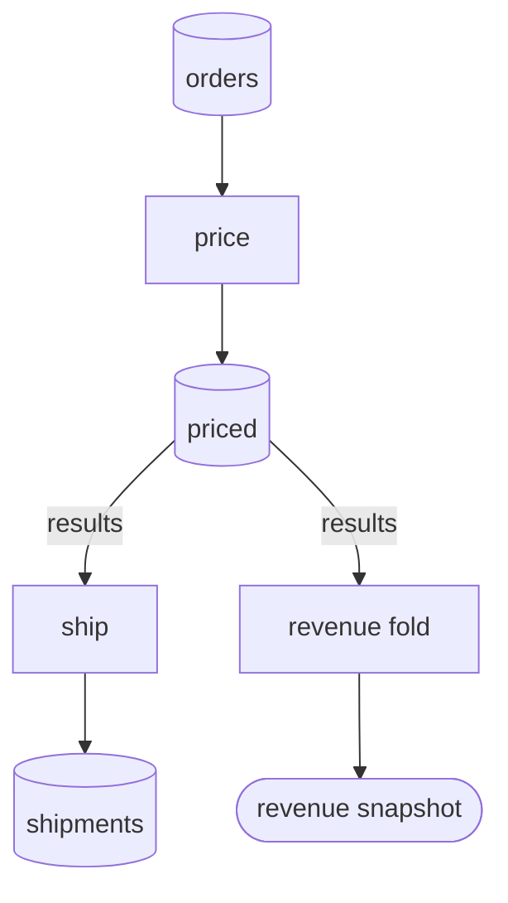

# An order pipeline

A shop appends each order to an `orders` channel. One tactic prices the
orders, adding tax by country; a second picks a carrier for each priced
order; and a small fold keeps a revenue snapshot up to date for a
dashboard. Bad orders do not stop the pipeline: they are recorded as error
events next to the results, where someone can look at them later.



## The program

```python title="order_pipeline.py"
from pydantic import BaseModel

from lllm import Tactic
from sssn import LocalStore, SnapshotNotFoundError, TacticProcessor

TAX_RATES = {"US": 0.0, "DE": 0.19, "FR": 0.20}


class Item(BaseModel):
    sku: str
    price: float
    quantity: int = 1


class Order(BaseModel):  # (1)!
    id: str
    country: str
    items: list[Item]


class Priced(BaseModel):
    order_id: str
    total: float
    tax: float


class Shipment(BaseModel):
    order_id: str
    carrier: str


class PriceOrder(Tactic):
    """Add tax to an order."""

    name = "price"
    input_model = Order
    output_model = Priced

    def call(self, order: Order) -> Priced:
        if order.country not in TAX_RATES:
            raise ValueError(f"no tax rate for {order.country}")
        subtotal = sum(item.price * item.quantity for item in order.items)
        tax = round(subtotal * TAX_RATES[order.country], 2)
        return Priced(order_id=order.id, total=subtotal + tax, tax=tax)


class ShipOrder(Tactic):
    """Pick a carrier for a priced order."""

    name = "ship"
    input_model = Priced
    output_model = Shipment

    def call(self, priced: Priced) -> Shipment:
        carrier = "freight" if priced.total > 500 else "parcel"
        return Shipment(order_id=priced.order_id, carrier=carrier)


def update_revenue(store: LocalStore) -> dict:
    """Fold newly priced orders into the revenue snapshot."""
    try:
        revenue = store.get_snapshot("revenue").value
    except SnapshotNotFoundError:
        revenue = {"total": 0.0, "orders": [], "cursor": 0}
    new = store.query_events(  # (2)!
        "priced", after_cursor=revenue["cursor"], kind="result"
    )
    for event in new:
        priced = Priced.model_validate(event.payload)
        if priced.order_id not in revenue["orders"]:  # (3)!
            revenue["orders"].append(priced.order_id)
            revenue["total"] += priced.total
        revenue["cursor"] = event.cursor
    if new:
        store.put_snapshot("revenue", revenue, source_event_id=new[-1].id)
    return revenue


store = LocalStore(".lllm/network")
for name in ("orders", "priced", "shipments"):
    store.create_channel({"name": name})

lamp = {"sku": "lamp", "price": 40.0, "quantity": 2}
desk = {"sku": "desk", "price": 300.0}
chair = {"sku": "chair", "price": 250.0}
orders = [
    {"id": "A-1", "country": "DE", "items": [lamp]},
    {"id": "A-2", "country": "BR", "items": [desk]},
    {"id": "A-3", "country": "US", "items": [desk, chair]},
    {"id": "A-4", "country": "FR"},
]
for order in orders:
    store.append_event(
        {"channel": "orders", "id": order["id"], "kind": "order",
         "payload": order, "correlation_id": order["id"]}  # (4)!
    )

pricing = TacticProcessor(
    PriceOrder(), store, source="orders", sink="priced", errors="record"
)
shipping = TacticProcessor(  # (5)!
    ShipOrder(), store, source="priced", sink="shipments", kind="result"
)
for event in pricing.process():
    outcome = event.payload["type"] if event.kind == "error" else "priced"
    print(event.correlation_id, outcome)
    #> A-1 priced
    #> A-2 ValueError
    #> A-3 priced
    #> A-4 SchemaError
for event in shipping.process():
    print(event.correlation_id, event.payload["carrier"])
    #> A-1 parcel
    #> A-3 freight
print(update_revenue(store))
#> {'total': 645.2, 'orders': ['A-1', 'A-3'], 'cursor': 7}
print(update_revenue(store)["total"])  # (6)!
#> 645.2

shipment = store.query_events("shipments")[-1]  # (7)!
priced = store.get_event(shipment.parent_ids[0])
order = store.get_event(priced.parent_ids[0])
print(order.id, order.payload["country"], priced.payload["total"])
#> A-3 US 550.0
for error in store.query_events("priced", kind="error"):
    print(error.parent_ids[0], error.payload["error"].splitlines()[0])
    #> A-2 no tax rate for BR
    #> A-4 Value does not match schema Order: 1 validation error for Order
```

1. The models are the contract between stages. `PriceOrder` validates
   each payload into an `Order` before `call()` runs, so `A-4`, which has
   no items, fails validation and never reaches the pricing code.
2. The snapshot stores the cursor it has read up to, next to the totals.
   Reading after that cursor and writing the snapshot back is one write
   per update, so a fold that stops halfway changes nothing and starts
   again from the same cursor.
3. Processing is at least once, so after a crash `priced` could hold two
   results for one order. The fold counts each order id once.
4. The order id doubles as the correlation id. Every event the pipeline
   writes about an order carries it.
5. The second stage reads `priced` with `kind="result"`, so recorded
   failures never reach it. Its default consumer is
   `ship-priced-result-processor`.
6. Running the fold again finds nothing new after cursor 7, so the total
   is unchanged.
7. Each event names its input in `parent_ids`, so two `get_event` calls
   walk from a shipment back to the order that caused it.

## How it works

**Each stage is a processor with its own subscription.** `pricing` reads
through `price-orders-processor` and `shipping` through
`ship-priced-result-processor`. Run each one in its own worker process and
restart either at any time: it resumes after the last event it
acknowledged, and neither knows the other exists.

**Failures are data.** With `errors="record"`, a bad order becomes an
`error` event in `priced`, with the exception's type and message, and the
pricing stage moves on. The errors stay queryable with
`query_events("priced", kind="error")`, and each one points at its order
through `parent_ids`. A failure that a retry could fix, such as a pricing
service that is down, is better left to `errors="raise"`, which stops the
stage and retries the same order next time
([Delivery](../processing.md#delivery-at-least-once)).

**The snapshot commits its own progress.** A dashboard should not
recompute revenue from the whole channel on every page view, so the fold
keeps the result in a snapshot. Because the snapshot's value includes the
cursor, the totals and the progress are written together, and
`source_event_id` names the last event folded in.

**The tactics are ordinary tactics.** Nothing in `PriceOrder` or
`ShipOrder` knows about channels. Each can be called directly in a test,
served with `lllm serve`, or replaced by a tactic whose `call()` asks an
agent, and the pipeline does not change.

## Make it yours

- Replace `PriceOrder` with an agent-backed tactic, such as one that reads
  orders out of customer emails ([Tactics](https://lllm.one/tactics/)).
- Run each stage as a worker loop around `process(limit=100)`
  ([Run a worker](../processing.md#run-a-worker)).
- Serve the store and run the stages on other machines with `RemoteStore`;
  the code above stays the same ([Over HTTP](../http.md)).
- Declare `orders`, `priced`, and `shipments` in a package's `lllm.toml`,
  so the hub lists them and other projects bind them by ref
  ([Packages and refs](../packages.md)).
