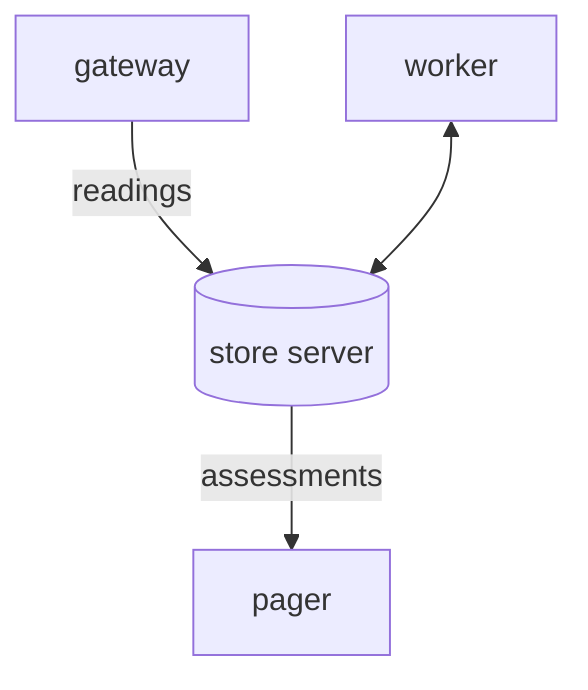

# Processes sharing a store

A gateway publishes temperature readings from a boiler. A worker assesses
each reading with a tactic, and a pager notifies on-call when an assessment
is an alert. The three run as separate processes, possibly on separate
machines, and share nothing but a store served over HTTP: every channel,
cursor, and event lives in the store, so any of them can stop, restart, or
move without telling the others.



## The program

To run in one file, this example starts the store server in a background
thread and plays the three processes in turn. In production each part is
its own process, as shown after the code.

```python title="shared_store.py"
import socket
import threading
import time

import uvicorn

from lllm import as_tactic
from sssn import (
    LocalStore,
    RemoteStore,
    RemoteStoreError,
    TacticProcessor,
    create_app,
)


def serve_in_background(app):  # (1)!
    with socket.socket() as probe:
        probe.bind(("127.0.0.1", 0))
        port = probe.getsockname()[1]
    config = uvicorn.Config(app, port=port, log_level="warning")
    server = uvicorn.Server(config)
    thread = threading.Thread(target=server.run, daemon=True)
    thread.start()
    while not server.started:
        time.sleep(0.05)
    return server, thread, f"http://127.0.0.1:{port}"


def tolerate(error_type, call, *args):
    """Call, treating one kind of server error as success."""
    try:
        call(*args)
    except RemoteStoreError as error:
        if error.error_type != error_type:
            raise


# The store server: what `sssn --store data/store serve` runs.
server, thread, url = serve_in_background(
    create_app(LocalStore("data/store"))
)

# Process 1: the gateway publishes readings.
gateway = RemoteStore(url)
for name in ("readings", "assessments"):
    tolerate("ChannelExistsError", gateway.create_channel, {"name": name})


def publish(reading_id, sensor, celsius):
    reading = {"sensor": sensor, "celsius": celsius}
    event = {"channel": "readings", "id": reading_id, "payload": reading}
    tolerate("EventExistsError", gateway.append_event, event)  # (2)!


publish("boiler-1", "boiler", 64.0)
publish("boiler-2", "boiler", 91.5)
publish("boiler-2", "boiler", 91.5)  # a retry after a timeout


# Process 2: the worker assesses each reading.
def assess(reading: dict) -> dict:
    level = "alert" if reading["celsius"] > 90 else "ok"
    return {"sensor": reading["sensor"], "level": level}


def start_worker():
    return TacticProcessor(
        as_tactic(assess), RemoteStore(url),
        source="readings", sink="assessments",
    )


worker = start_worker()
print([event.payload["level"] for event in worker.process()])
#> ['ok', 'alert']
publish("boiler-3", "boiler", 88.0)
worker = start_worker()  # (3)!
print([event.payload["level"] for event in worker.process()])
#> ['ok']

# Process 3: the pager reads assessments through its own subscription.
pager = RemoteStore(url)
pager.create_subscription("assessments", subscription_id="pager")
for event in pager.pull_subscription("pager"):  # (4)!
    if event.payload["level"] == "alert":
        print("page on-call:", event.parent_ids[0])
        #> page on-call: boiler-2

print([event.id for event in gateway.query_events("readings")])  # (5)!
#> ['boiler-1', 'boiler-2', 'boiler-3']
server.should_exit = True
thread.join()
```

1. Only for this example: it runs the store server on a free local port.
   In production, `sssn serve` runs it (see below).
2. The gateway names each reading. If a request times out after the server
   stored the event, the retry gets a 409 `EventExistsError`, which means
   the reading is already there.
3. A new processor, as after a restart, finds its subscription,
   `assess-readings-processor`, in the store and processes only
   `boiler-3`.
4. `pull_subscription` returns the pending events and moves the cursor
   past them in the same call. A second pull returns nothing.
5. Three readings, though the gateway sent four requests.

## Running it as separate processes

Start the store server, then run each part as its own program, on this
machine or on others that can reach the server:

```bash
sssn --store data/store serve --host 0.0.0.0 --port 7700
python gateway.py
python worker.py
python pager.py
```

Each program is its part of the file above, with the server's URL in place
of the background thread. The worker becomes a loop:

```python title="worker.py" test="skip" reason="needs a running store server"
import time

from lllm import as_tactic
from sssn import RemoteStore, TacticProcessor

from sensors import assess  # the function above

worker = TacticProcessor(
    as_tactic(assess), RemoteStore("http://store.internal:7700"),
    source="readings", sink="assessments",
)
while True:
    if not worker.process(limit=100):
        time.sleep(1.0)
```

## How it works

**The store is the only shared state.** The worker's progress is its
subscription and the pager's is another, both kept in the store. A process
holds nothing that would be lost if it stopped, so you can restart the
worker during a deploy, run it on another machine, or replace it with a
new version, and it resumes after the last event it acknowledged.

**Ids make producers safe to retry.** A network call can fail after the
server has done the work. Because each reading has an id, the gateway
retries freely and the store keeps one copy; the 409 tells it the first
attempt succeeded ([Errors](../http.md#errors)).

**Each consumer picks its delivery.** The worker uses `TacticProcessor`,
which acknowledges a reading only after its assessment is written: at
least once, so no reading goes unassessed, and a repeat after a crash is
harmless. The pager uses `pull_subscription`, which acknowledges as it
reads: at most once, so a crash can drop a page, but on-call is never paged
twice. Choose per consumer, by which mistake is cheaper.

**Remote code is local code.** Every process uses `RemoteStore`, which has
the same methods as `LocalStore`. Test `assess` and the pager's loop
against a `LocalStore` in a temporary folder, and deploy them against the
server unchanged ([The store interface](../stores.md#the-store-interface)).

## Make it yours

- Bind the store's URL to a channel ref in `.lllm/config.toml`, so the
  programs call `resolver.store(ref)` instead of hard-coding the URL
  ([Packages and refs](../packages.md#bind-refs-to-stores)).
- Put the server behind authentication before it leaves localhost
  ([Securing a store](../http.md#securing-a-store)).
- Run the worker in an async service with `AsyncRemoteStore` and
  `aprocess()` ([Remote and async stores](../processing.md#remote-and-async-stores)).
- Give the pager a dashboard: keep the latest level per sensor in a
  snapshot, as the [order pipeline](order-pipeline.md) does for revenue.
