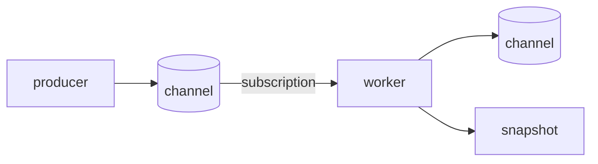

# Simple System of Systems Network

<p class="psi-brand">
  
  
</p>

[sssn.one](https://sssn.one){ .psi-domain }

**SSSN** is the protocol and service layer for semantic channels, built on
[LLLM](https://lllm.one/). A channel is a named, append-only stream of
events that one system writes and others read, and each event says what
happened, who wrote it, and what it came from. Services, workers, robots,
apps, and agents use channels to hand work to each other when they run at
different times, in different processes, or on different machines.

## Why SSSN

LLLM composes: a [tactic](https://lllm.one/tactics/) is a program you call,
and it answers. Many systems do not fit a call. A camera produces frames
whether or not anyone is watching, a reviewer works through a queue at its
own pace, and a nightly job needs everything that arrived since its last
run. Channels connect such systems:

- **Writers and readers never meet.** A producer appends events to a
  channel, and each consumer reads them through its own
  [subscription](subscriptions.md). Neither needs the other to be running.
- **Readers resume.** A subscription's cursor lives in the store, so a
  worker that restarts continues where it stopped.
- **Every record is traceable.** [Events](channels.md) carry `kind`,
  `source`, `correlation_id`, and `parent_ids`, so a result points back at
  the event that produced it, across channels.
- **Bulk data and state have their own place.**
  [Artifacts](artifacts.md) hold large payloads beside events, and
  [snapshots](artifacts.md#snapshots) hold the latest value of a name.
- **One interface, any store.** `LocalStore` keeps channels in a folder,
  `sssn serve` puts the same API on [HTTP](http.md), and `RemoteStore`
  calls it with the same methods.
- **Any tactic can work a channel.** `TacticProcessor` runs an LLLM tactic
  over a channel's events and writes the results to another channel.

## A first channel

```python title="first_channel.py"
from sssn import LocalStore

store = LocalStore(".lllm/network")  # (1)!
store.create_channel({"name": "inbox"})  # (2)!
store.append_event({"channel": "inbox", "payload": "Checkout is down"})
store.append_event({"channel": "inbox", "payload": "How do I export?"})

for event in store.query_events("inbox"):  # (3)!
    print(event.cursor, event.payload)
    #> 1 Checkout is down
    #> 2 How do I export?
```

1. A `LocalStore` is a folder: SQLite for the records, plain files for
   artifacts. `.lllm/network` is the default, and the `sssn` command uses
   the same one.
2. A channel is a name that writers and readers agree on. Appending to a
   channel that does not exist raises `ChannelNotFoundError`.
3. Events come back in the order they were appended. Each has a `cursor`,
   its position in the store, which readers use to continue from where they
   stopped.

The events are on disk, so another process that opens the same folder sees
them, and so does the command line: `sssn query-events inbox`.

## A real program: a tactic over a channel

Here is the shape SSSN is built for. Support tickets arrive in one channel,
a tactic routes each one, and the routes go to a second channel. Each
result points back at its ticket:

```python title="triage.py"
from pydantic import BaseModel

from lllm import Tactic
from sssn import LocalStore, TacticProcessor


class Ticket(BaseModel):
    text: str


class Route(BaseModel):
    queue: str


class Triage(Tactic):  # (1)!
    """Route a support ticket to a queue."""

    name = "triage"
    input_model = Ticket
    output_model = Route

    def call(self, ticket: Ticket) -> Route:
        urgent = "down" in ticket.text.lower()
        return Route(queue="oncall" if urgent else "support")


store = LocalStore(".lllm/network")
store.create_channel({"name": "inbox"})
store.create_channel({"name": "routed"})
for ticket_id, text in [("T-1", "Checkout is down"), ("T-2", "Dark mode?")]:
    store.append_event(
        {
            "channel": "inbox",
            "kind": "ticket",
            "correlation_id": ticket_id,  # (2)!
            "payload": {"text": text},
        }
    )

worker = TacticProcessor(Triage(), store, source="inbox", sink="routed")
for result in worker.process():  # (3)!
    print(result.correlation_id, result.payload)
    #> T-1 {'queue': 'oncall'}
    #> T-2 {'queue': 'support'}
print(worker.process())  # (4)!
#> []

route = store.query_events("routed")[0]
ticket = store.get_event(route.parent_ids[0])  # (5)!
print(ticket.payload["text"], "->", route.payload["queue"])
#> Checkout is down -> oncall
```

1. A plain tactic keeps this example offline. A tactic whose `call()` runs
   agents works the same way ([Tactics](https://lllm.one/tactics/)), and so
   does any other LLLM tactic.
2. A correlation id groups the events of one piece of work, here one
   ticket, across every channel it passes through.
3. The worker reads `inbox` through a subscription, validates each payload
   into a `Ticket`, runs the tactic, and appends the `Route` to `routed`.
4. Nothing is pending. The subscription remembers where the worker stopped,
   so a restarted worker skips the tickets it has already routed.
5. Every output lists its input in `parent_ids`, so any result can be
   traced back to what produced it.

[Processing with tactics](processing.md) covers what the tactic receives,
what happens when it fails, and long-running workers.

## Serve it

`sssn serve` puts a store folder behind an HTTP API (with the `server`
extra):

```bash
sssn serve --port 7700
curl -s "localhost:7700/events?channel=routed"
```

`RemoteStore("http://127.0.0.1:7700")` has the same methods as
`LocalStore`, so the worker above runs unchanged against a store on another
machine. See [Over HTTP](http.md).

## How the pieces fit



Six objects carry the design:

- **Channel is the address.** A name, a form, and a description that
  writers and readers agree on.
- **Event is the record.** A JSON payload in an envelope of ids, kind,
  source, and links to other events. Events are never changed or deleted.
- **Artifact is the bulk data.** Bytes stored beside events and linked to
  them by id.
- **Snapshot is the current state.** The latest value of a name, pointing
  at the event that produced it.
- **Subscription is the reader.** A named cursor over one channel.
- **Store is where they live.** A folder for one machine, or a server for
  many.

[How SSSN works](concepts.md) explains the model in one page.

## Next steps

- [Install SSSN](install.md).
- Learn to write and read [channels and events](channels.md).
- Store bulk data and state with [artifacts and snapshots](artifacts.md).
- Consume channels reliably with [subscriptions](subscriptions.md).
- Run a tactic over a channel with
  [processing with tactics](processing.md).
- Browse complete [examples](examples/index.md).

## The LLLM family

LLLM composes, SSSN connects, and AAAX exposes:

- **[LLLM](https://lllm.one/)** builds agentic programs: tactics, agents,
  and prompts, packaged with an `lllm.toml` and shared on the
  [LLLM Hub](https://lllm.one/publishing/).
- **SSSN** (`pip install sssn`) connects systems through channels. A
  package can declare its channels in `lllm.toml`, and `lllm://` refs bind
  them to stores ([Packages and refs](packages.md)). Installing SSSN adds
  `lllm network` to the `lllm` command.
- **[AAAX](https://aaax.one/)** (`pip install aaax`) mounts tactics and
  channels into one strategy and serves them as a single API
  ([Channels in AAAX](https://aaax.one/channels/)).

SSSN's channels grew out of two settings. In SocioDojo (ICLR 2024), news,
articles, and time series flow into lifelong analytical agents as feeds
they subscribe to. In Genesys, from *Language Modeling by Language Models*
(NeurIPS 2025), agents publish findings, code, and results to a shared
blackboard, then inspect and build on each other's work. Channels keep both
patterns behind one neutral interface.
