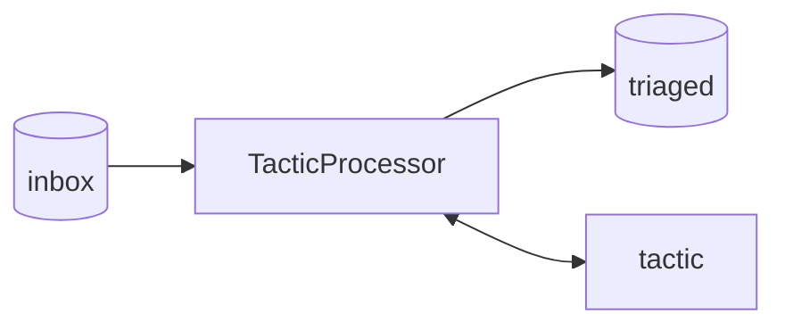
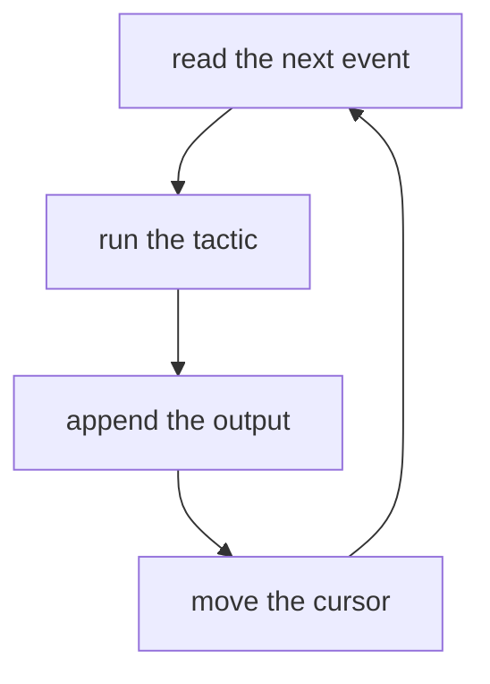

# Processing with tactics

`TacticProcessor` runs an [LLLM](https://lllm.one/) tactic over a channel.
It reads the channel through a named subscription, passes each event's
payload to the tactic, and appends the result to a sink channel as an event
that points back at its input. The subscription lives in the store, so a
processor resumes where it stopped, and an event is acknowledged only after
its output is written, so every event is processed at least once.



```python title="triage_worker.py"
from pydantic import BaseModel

from lllm import Tactic
from sssn import LocalStore, TacticProcessor


class Ticket(BaseModel):
    text: str


class Triage(BaseModel):
    priority: str


class TriageTicket(Tactic):  # (1)!
    """Mark tickets that report an outage as urgent."""

    name = "triage"
    input_model = Ticket
    output_model = Triage

    def call(self, ticket: Ticket) -> Triage:
        words = set(ticket.text.lower().split())
        urgent = words & {"down", "outage", "broken"}
        return Triage(priority="urgent" if urgent else "normal")


store = LocalStore(".lllm/network")
store.create_channel({"name": "inbox"})
store.create_channel({"name": "triaged"})  # (2)!
tickets = {"T-1": "Checkout is down", "T-2": "How do I export my data?"}
for ticket_id, text in tickets.items():
    store.append_event(
        {"channel": "inbox", "id": ticket_id, "payload": {"text": text}}
    )

processor = TacticProcessor(
    TriageTicket(), store, source="inbox", sink="triaged"
)
for event in processor.process():  # (3)!
    print(event.parent_ids, event.payload)
    #> ('T-1',) {'priority': 'urgent'}
    #> ('T-2',) {'priority': 'normal'}
print(processor.process())  # (4)!
#> []
```

1. Any LLLM tactic works. This one is plain Python, so the example runs
   without a model. A tactic whose `call()` asks agents
   ([Tactics](https://lllm.one/tactics/)), a function wrapped with
   `as_tactic(fn)`, or a `RemoteTactic` that calls a served tactic plugs in
   the same way.
2. Create the sink before processing. The processor appends to it but does
   not create it.
3. `process()` handles every pending event and returns the events it wrote
   to the sink. Each one names its input in `parent_ids`.
4. The processor reads through a subscription named
   `triage-inbox-processor`, kept in the store. A new processor for the same
   tactic and channel, in this process or after a restart, starts after
   `T-2`.

| Argument | Default | Meaning |
| --- | --- | --- |
| `tactic` | required | Any LLLM tactic |
| `store` | required | Any store; an async store needs [`aprocess()`](#remote-and-async-stores) |
| `source` | required | The channel to read |
| `sink` | `None` | The channel to write outputs to; without one, `process()` returns the outputs |
| `consumer` | `"<tactic name>-<source>-processor"` | The subscription's id ([Consumers](#consumers)) |
| `kind` | `None` | Process only source events of this kind |
| `output_kind` | `"result"` | The `kind` of output events |
| `errors` | `"raise"` | What a failure does: `"raise"` or `"record"` ([below](#record-failures-instead-of-raising)) |

## What the tactic sees

The tactic's input is the event's payload, validated against the tactic's
input model as in any tactic call. The tactic does not get the event
itself, but a `call()` that declares `context` receives a `CallContext`
that describes it. This tactic returns the context it receives:

```python title="context.py"
from lllm import Tactic
from sssn import LocalStore, TacticProcessor


class ShowContext(Tactic):
    name = "show"

    def call(self, payload: dict, *, context=None):
        return context


store = LocalStore(".lllm/network")
store.create_channel({"name": "inbox"})
store.append_event(
    {"channel": "inbox", "id": "msg-1", "kind": "chat",
     "payload": {"text": "hi"}, "correlation_id": "conv-7"}
)
processor = TacticProcessor(ShowContext(), store, source="inbox")
[context] = processor.process()  # (1)!
print(context.caller, context.tags)
#> show-inbox-processor {'channel': 'inbox'}
print(context.metadata)
#> {'event_id': 'msg-1', 'event_kind': 'chat', 'correlation_id': 'conv-7'}
```

1. Without a sink, `process()` returns the tactic's outputs, which is
   handy in tests.

| Context field | Value |
| --- | --- |
| `caller` | The consumer name |
| `tags` | `{"channel": <source>}` |
| `metadata["event_id"]` | The input event's id |
| `metadata["event_kind"]` | The input event's kind |
| `metadata["correlation_id"]` | The input's `correlation_id`, or its id when it has none |

A `RemoteTactic` sends the context with its request, so a served tactic
sees the same fields. The event id also makes a good idempotency key
([Delivery](#delivery-at-least-once)).

## What the processor writes

Each output event carries the result and its lineage:

| Field | Value |
| --- | --- |
| `channel` | The sink |
| `source` | The consumer name |
| `kind` | `output_kind`, `"result"` by default |
| `payload` | The result as JSON; Pydantic models are dumped with `model_dump(mode="json")` |
| `parent_ids` | `(input.id,)` |
| `correlation_id` | The input's `correlation_id`, or the input's id |

Because each output names its input and keeps its correlation id, a chain
of processors stays traceable: from any output, `get_event(parent_id)`
walks back to the event that caused it, as the
[order pipeline](examples/order-pipeline.md) example shows.

## Delivery: at least once

Events are processed one at a time, in cursor order. For each event, the
processor reads it at the subscription cursor without moving the cursor,
runs the tactic, appends the output to the sink, and only then acknowledges
the event by moving the cursor past it. This is the at-least-once loop from
[Subscriptions](subscriptions.md#acknowledging-events), run for you:



If anything stops the loop before the cursor moves, the event is still
pending, and the next `process()` call runs it again. With
`errors="raise"`, the default, a failure propagates out of `process()`,
and the next call retries the failed event before any event behind it:

```python title="retry.py"
from lllm import Tactic
from sssn import LocalStore, TacticProcessor

outages = ["timeout"]  # (1)!


class Charge(Tactic):
    name = "charge"

    def call(self, order: dict) -> dict:
        if order["id"] == "A-2" and outages:
            raise ConnectionError(f"payment API {outages.pop()}")
        return {"charged": order["total"]}


store = LocalStore(".lllm/network")
store.create_channel({"name": "orders"})
store.create_channel({"name": "charges"})
for order_id, total in [("A-1", 10), ("A-2", 25), ("A-3", 5)]:
    order = {"id": order_id, "total": total}
    event = {"channel": "orders", "id": order_id, "payload": order}
    store.append_event(event)

processor = TacticProcessor(
    Charge(), store, source="orders", sink="charges"
)
try:
    processor.process()
except ConnectionError as error:
    print("stopped:", error)  # (2)!
    #> stopped: payment API timeout
print([event.parent_ids[0] for event in store.query_events("charges")])
#> ['A-1']

outputs = processor.process()  # (3)!
print([event.parent_ids[0] for event in outputs])
#> ['A-2', 'A-3']
```

1. Stands in for a payment service that times out once and then recovers.
2. `A-1` was charged and acknowledged. `A-2` failed, so it stays pending.
3. The next call runs `A-2` again before `A-3`. Events are not skipped and
   keep their order.

A worker can also stop after the output is written but before the cursor
moves, for example when it is killed. Then the event runs again, and the
sink gets a second output for it:

```python title="duplicates.py"
from lllm import as_tactic
from sssn import LocalStore, TacticProcessor


class StopsBeforeAck(LocalStore):  # (1)!
    stops = 1

    def pull_subscription(self, subscription_id, *, limit=None):
        if self.stops:
            self.stops -= 1
            raise RuntimeError("worker killed")
        return super().pull_subscription(subscription_id, limit=limit)


def label(order: dict) -> dict:
    return {"label": f"SHIP-{order['id']}"}


store = StopsBeforeAck(".lllm/network")
store.create_channel({"name": "orders"})
store.create_channel({"name": "labels"})
order = {"channel": "orders", "id": "A-1", "payload": {"id": "A-1"}}
store.append_event(order)

processor = TacticProcessor(
    as_tactic(label), store, source="orders", sink="labels"
)
try:
    processor.process()  # (2)!
except RuntimeError as error:
    print(error)
    #> worker killed
processor.process()
labels = store.query_events("labels")
print([(event.parent_ids, event.payload["label"]) for event in labels])
#> [(('A-1',), 'SHIP-A-1'), (('A-1',), 'SHIP-A-1')]
```

1. Only for this example: a store that fails the first acknowledgment
   (processors acknowledge with `pull_subscription`), as if the worker died
   right after writing its output.
2. The label for `A-1` is written, but the event is not acknowledged, so
   the second call runs it again.

So make tactics safe to repeat, and let readers of a sink keep one output
per parent id. A pure function of its input, like `label`, is safe as it
is. A tactic with side effects, like `Charge`, should check whether it
already acted, for example by sending `context.metadata["event_id"]` to the
payment service as an idempotency key.

## Record failures instead of raising

With `errors="record"`, a failure is written to the sink as an event with
`kind="error"`, the failed event is acknowledged, and processing continues:

```python title="record_errors.py"
from pydantic import BaseModel

from lllm import Tactic
from sssn import LocalStore, TacticProcessor


class Ticket(BaseModel):
    text: str


class Classify(Tactic):
    name = "classify"
    input_model = Ticket

    def call(self, ticket: Ticket) -> dict:
        if not ticket.text.strip():
            raise ValueError("empty ticket")
        return {"words": len(ticket.text.split())}


store = LocalStore(".lllm/network")
store.create_channel({"name": "inbox"})
store.create_channel({"name": "classified"})
payloads = {
    "T-1": {"text": "Login fails"},
    "T-2": {"text": " "},
    "T-3": {"subject": "no text"},
    "T-4": {"text": "Thanks!"},
}
for ticket_id, payload in payloads.items():
    event = {"channel": "inbox", "id": ticket_id, "payload": payload}
    store.append_event(event)

processor = TacticProcessor(
    Classify(), store, source="inbox", sink="classified", errors="record"
)
outputs = processor.process()
for event in outputs:
    print(event.parent_ids[0], event.kind)
    #> T-1 result
    #> T-2 error
    #> T-3 error
    #> T-4 result
print(outputs[1].payload)
#> {'error': 'empty ticket', 'type': 'ValueError'}
print(outputs[2].payload["type"])  # (1)!
#> SchemaError
errors = store.query_events("classified", kind="error")  # (2)!
print([event.parent_ids[0] for event in errors])
#> ['T-2', 'T-3']
```

1. `T-3` does not fit `Ticket`, so the call fails before `call()` runs,
   with LLLM's `SchemaError`.
2. Failures stay queryable. A processor that reads `classified` further
   down a pipeline passes `kind="result"` to skip them.

An error event's payload is
`{"error": str(exc), "type": type(exc).__name__}`, with the same `source`,
`parent_ids`, and `correlation_id` as an output. A failure to write the
output, such as a result that cannot become JSON, is recorded the same
way. `"record"` needs a sink; without one it acts like `"raise"`. If the
error event cannot be written either, `process()` raises and the event
stays pending.

Use `"record"` when a failure belongs to the event, such as bad input, so
that one bad event cannot block the channel. Keep `"raise"` when a failure
means something outside is wrong, such as a service that is down, and a
later retry will succeed.

## Consumers

The consumer is the processor's name in the store: the id of its
subscription and the `source` of the events it writes. By default it joins
the tactic's name, the source, and the `kind` filter:
`"<tactic name>-<source>-processor"`, or
`"<tactic name>-<source>-<kind>-processor"` with a `kind`. Processors with
different consumers each see every event:

```python title="consumers.py"
from lllm import as_tactic
from sssn import LocalStore, TacticProcessor


def word_count(post: dict) -> int:
    return len(post["text"].split())


def shout(post: dict) -> str:
    return post["text"].upper()


store = LocalStore(".lllm/network")
store.create_channel({"name": "posts"})
for kind, text in [("post", "hello world"), ("comment", "nice")]:
    event = {"channel": "posts", "kind": kind, "payload": {"text": text}}
    store.append_event(event)

counter = TacticProcessor(as_tactic(word_count), store, source="posts")
shouter = TacticProcessor(
    as_tactic(shout), store, source="posts", kind="post"
)
print(counter.consumer, counter.process())  # (1)!
#> word_count-posts-processor [2, 1]
print(shouter.consumer, shouter.process())
#> shout-posts-post-processor ['HELLO WORLD']
```

1. The tactic's name is its `tactic_name`: the `name` of a `Tactic`
   class, or the function's name for `as_tactic(fn)`.

- **Run one worker per consumer.** Two workers on one consumer can process
  the same event twice and, with `errors="raise"`, lose one. To spread a
  channel's work, give each worker its own share, such as a `kind`
  ([Subscriptions](subscriptions.md#several-consumers-on-one-channel)).
- **Name consumers that would collide.** The sink is not part of the
  default name, so the same tactic reading the same channel into two sinks
  needs `consumer=`.
- **Start over with a new name.** A new consumer reads the channel from the
  beginning.
- **A consumer keeps its channel and filter.** Reusing a consumer name with
  another source or `kind` makes `process()` raise `ValueError`.
- **Names must fit in a URL.** If the default name would contain
  whitespace, `?`, or `#`, the constructor raises `ValueError`; pass
  `consumer=`.

## Run a worker

`process(limit=None)` handles pending events until there are none, or
until it has `limit` results (outputs and recorded errors together). A
store does not notify its readers, so a long-running worker is a loop that
sleeps when there is nothing to do:

```python test="skip" reason="runs until it is stopped"
import time


def run_worker(processor, *, idle_seconds=1.0):
    while True:
        if not processor.process(limit=100):
            time.sleep(idle_seconds)
```

## Remote and async stores

The processor calls only store methods, so `process()` works on a
`RemoteStore` as it does on a `LocalStore`. `aprocess()` is the async
variant: it runs the tactic with `arun()` and awaits each store call, so it
works with `AsyncRemoteStore` as well as the synchronous stores, with the
same delivery guarantees. `process()` raises `TypeError` for an async
store.

```python title="async_worker.py"
import asyncio

import httpx

from lllm import as_tactic
from sssn import AsyncRemoteStore, LocalStore, TacticProcessor, create_app

served = LocalStore(".lllm/network")
served.create_channel({"name": "posts"})
served.create_channel({"name": "stats"})
served.append_event({"channel": "posts", "payload": {"text": "hi there"}})
app = create_app(served)


def word_count(post: dict) -> dict:
    return {"words": len(post["text"].split())}


async def main():
    store = AsyncRemoteStore(
        "http://store.internal:7700",
        transport=httpx.ASGITransport(app=app),  # (1)!
    )
    processor = TacticProcessor(
        as_tactic(word_count), store, source="posts", sink="stats"
    )
    outputs = await processor.aprocess()
    print([event.payload for event in outputs])
    #> [{'words': 2}]


asyncio.run(main())
```

1. Only for this example: requests go to the app in this process. Against
   a running server, pass the URL alone ([Over HTTP](http.md)).

To get both the tactic and the store by `lllm://` ref, so the same worker
code runs against local or served ones, use `lllm.Resolver`
([Packages and refs](packages.md#tactics-and-channels-from-one-config)).
